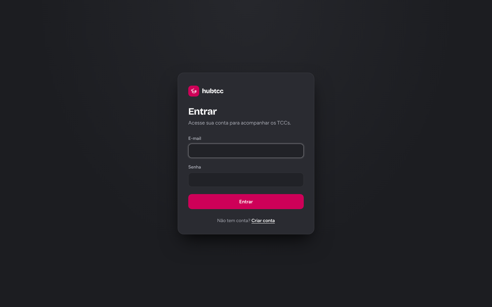
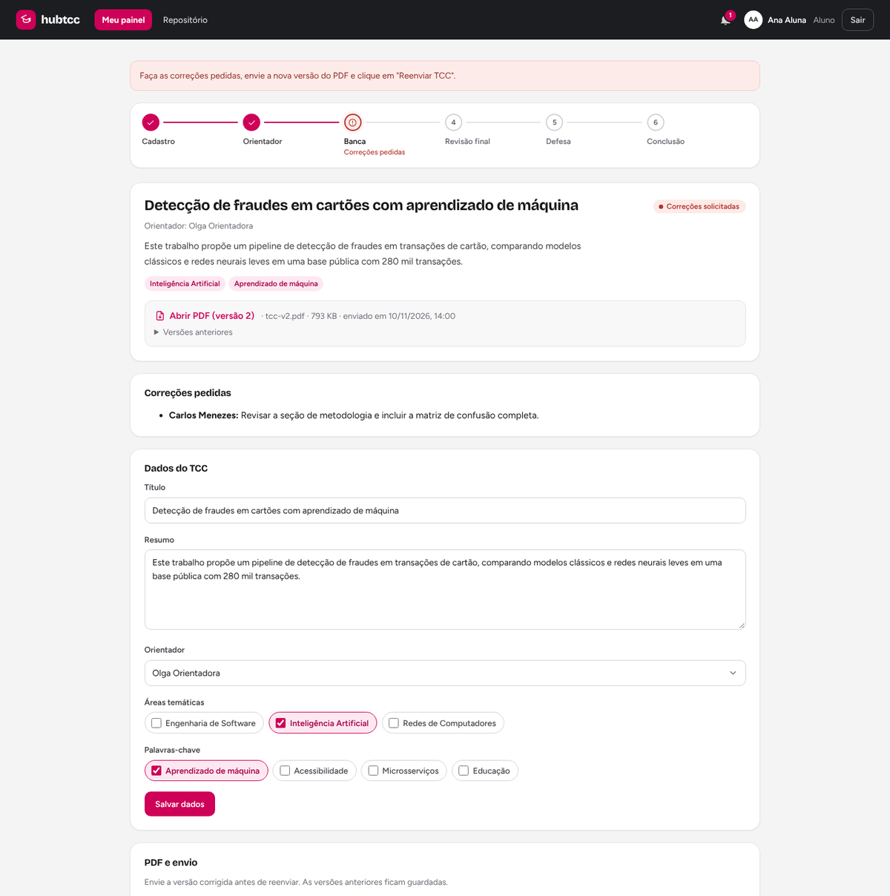
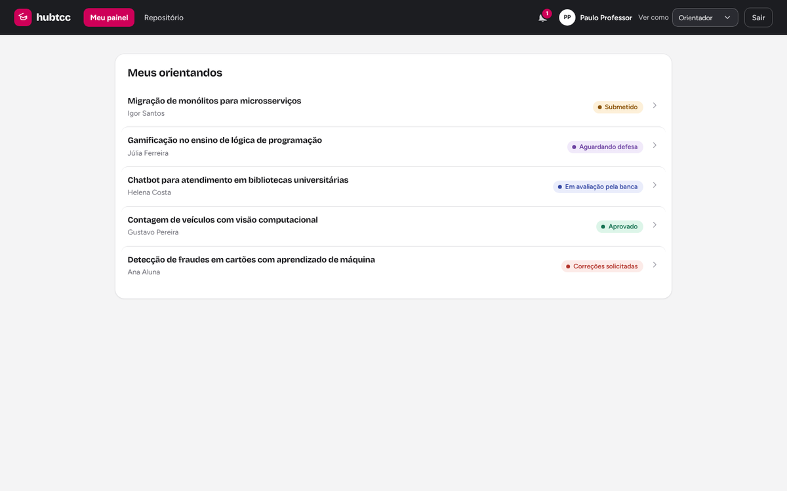
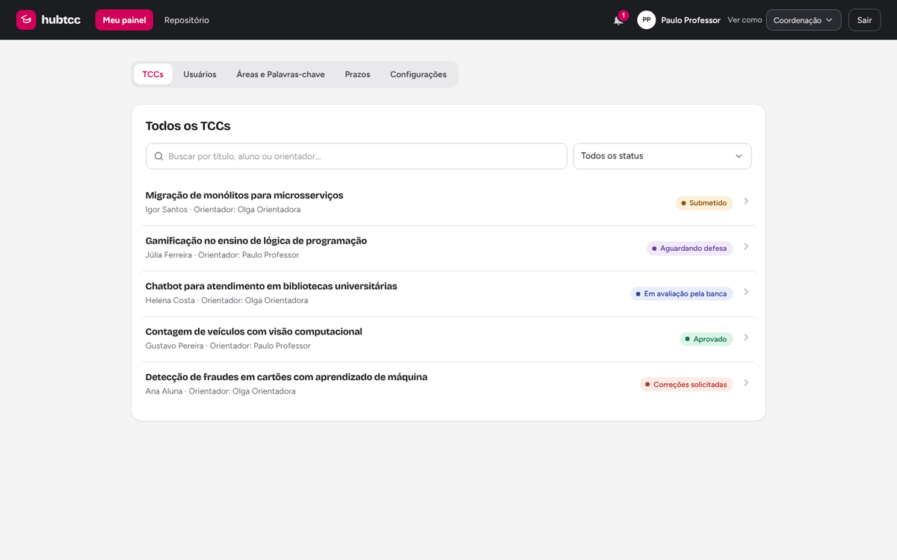
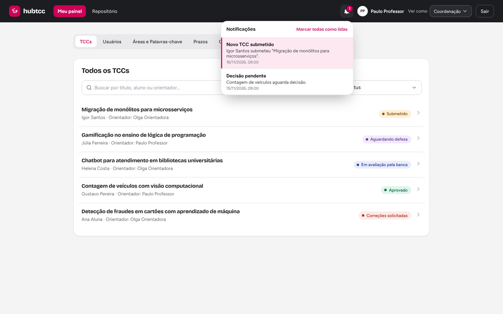
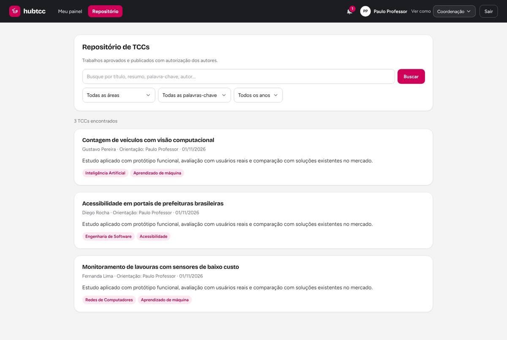

# hubtcc — Sistema de Cadastro e Acompanhamento de TCC

[](https://github.com/Jeda-Ismael/TccHub/actions/workflows/ci.yaml)

O **hubtcc** é um sistema web para faculdades acompanharem os Trabalhos de Conclusão de Curso (TCC) do começo ao fim. O aluno cadastra o trabalho e envia o PDF. Depois vêm a revisão do orientador, a banca, a defesa com notas e, no final, a publicação num repositório pesquisável.

O fluxo de negócio foi inspirado no [deposito-tcc](https://github.com/pcalvesUSP/deposito-tcc) (USP) e reimplementado do zero, sem depender da infraestrutura de nenhuma instituição.

---

## O que o sistema faz

**Quatro papéis**, cada um com a sua tela:

| Papel | O que faz |
|---|---|
| **Aluno** | Cadastra o TCC (título, resumo, orientador, áreas e palavras-chave), envia o PDF (cada envio vira uma nova versão), acompanha o andamento e autoriza a publicação |
| **Orientador** | Revisa o TCC antes da banca, faz a revisão final e agenda a defesa |
| **Avaliador** | Dá o parecer como membro da banca e lança as notas da defesa |
| **Coordenação** | Monta as bancas, decide os casos de nota baixa, publica no repositório e administra usuários, prazos e configurações |

Um professor pode ter mais de um papel ao mesmo tempo (por exemplo, orientador e avaliador) e troca de papel no topo da tela.

**O caminho de um TCC:**

```
Rascunho → Submetido → Em avaliação pela banca ⇄ Correções solicitadas
        → Revisão final do orientador → Aguardando defesa → Aprovado → Publicado no repositório
                                                         ↘ Aguardando decisão → nova defesa ou reprovado
```

1. O aluno cadastra o TCC, envia o PDF e submete dentro do prazo.
2. A coordenação monta a banca. O orientador nunca avalia o próprio orientando.
3. O orientador aprova o envio à banca.
4. Cada avaliador dá o parecer **às cegas**: ninguém vê o parecer dos colegas antes de todos votarem. Se alguém pedir correções, o aluno envia uma nova versão e a rodada recomeça.
5. O orientador faz a revisão final e agenda a defesa (data, sala ou link).
6. Depois da defesa, cada avaliador lança as notas de **projeto** e de **apresentação**. A média sai sozinha: com média 6,0 ou mais (valor configurável), o TCC é aprovado; abaixo disso, a coordenação decide entre uma nova defesa e a reprovação.
7. O aluno autoriza a publicação e a coordenação publica. Qualquer usuário logado encontra o trabalho no **repositório**, com busca em português que ignora acentos ("fraude" acha "fraudes", "cartao" acha "cartões").

**Também tem:**

- **Notificações no sininho:** cada pessoa é avisada do que precisa fazer, e o clique leva direto ao TCC.
- **Histórico completo:** quem fez o quê e quando, com os comentários.
- **Versões do PDF:** as versões anteriores ficam guardadas.
- **Prazos:** períodos de submissão e de avaliação.
- **Layout para celular.**

---

## Telas

Prints com os dados de demonstração.

**Login**



**Aluno:** acompanha em que etapa está o TCC, vê as correções pedidas pela banca e envia a nova versão do PDF.



**Orientador:** vê os orientandos e o status de cada TCC.



**Coordenação:** acompanha todos os TCCs e administra usuários, áreas, palavras-chave, prazos e configurações.



**Notificações:** o sininho avisa cada pessoa do que precisa fazer.



**Repositório:** os TCCs publicados, com busca e filtros por área, palavra-chave e ano.



---

## Tecnologias

| Parte | Tecnologia |
|---|---|
| API (`api/`) | PHP 8.3+ com [Symfony 7.4](https://symfony.com/), Doctrine ORM e PostgreSQL 16, servida por [FrankenPHP](https://frankenphp.dev/) |
| Telas (`web/`) | [React 18](https://react.dev/), Vite, TypeScript, React Query e React Router |
| Login | JWT, com renovação automática por cookie seguro |
| Busca | Busca de texto completo do próprio PostgreSQL, em português e sem acentos |
| Ambiente | [Docker](https://www.docker.com/) e Docker Compose. Você não precisa instalar PHP, Node ou PostgreSQL na máquina |
| Qualidade | PHPUnit, PHPStan (nível 8), PHP-CS-Fixer, Vitest e Testing Library. A CI exige pelo menos 85% de cobertura de testes |

---

## Como rodar na sua máquina

Tudo roda dentro do Docker, e o processo é o mesmo no **Windows**, no **macOS** e no **Linux**.

### 1. Instale o que precisa

- **[Docker Desktop](https://www.docker.com/products/docker-desktop/)** (Windows e macOS) ou Docker Engine com o plugin Compose (Linux). Depois de instalar, **abra o Docker Desktop** e espere aparecer "Engine running".
- **[Git](https://git-scm.com/downloads)**.

Para conferir, abra um terminal (no Windows, o PowerShell) e rode:

```bash
docker --version
docker compose version
git --version
```

### 2. Baixe o projeto

```bash
git clone https://github.com/Jeda-Ismael/TccHub.git
cd TccHub
```

### 3. Suba o sistema

```bash
docker compose up -d --wait
```

A **primeira vez** demora alguns minutos, porque o Docker baixa as imagens e instala as dependências. Nas próximas vezes leva segundos. O próprio sistema cria as tabelas do banco ao subir.

### 4. Carregue os dados de demonstração

```bash
docker compose exec php bin/console doctrine:fixtures:load -n --group=demo
```

Isso cria os usuários de teste, TCCs em várias etapas do fluxo e quatro TCCs já publicados no repositório.

> ⚠️ Esse comando **apaga os dados que já estiverem no banco**. Para ter só os usuários, sem TCCs, troque `--group=demo` por `--group=base`.

### 5. Abra no navegador

Acesse **http://localhost:5173** e entre com uma das contas abaixo. A senha de todas é `123456`.

| E-mail | Papel |
|---|---|
| `aluno@hubtcc.dev` e `aluno2@hubtcc.dev` | Aluno, ainda sem TCC (bom para testar o fluxo do zero) |
| `orientador@hubtcc.dev` | Orientador |
| `avaliador1@hubtcc.dev` e `avaliador2@hubtcc.dev` | Avaliador |
| `coordenacao@hubtcc.dev` | Coordenação |
| `professor@hubtcc.dev` | Orientador + Avaliador + Coordenação |

### Endereços úteis

| O quê | Endereço |
|---|---|
| Sistema | http://localhost:5173 |
| API (teste rápido) | http://localhost:5173/api/health |
| API direta | https://localhost/api/health (na primeira vez o navegador avisa sobre o certificado local; pode aceitar) |
| Banco de dados | `localhost:5432`, usuário `app`, senha `app`, banco `hubtcc` |
| Adminer (ver o banco pelo navegador) | Rode `docker compose --profile tools up -d adminer` e abra http://localhost:8080 |

### Parar, voltar e atualizar

```bash
docker compose down        # para tudo (os dados continuam salvos)
docker compose up -d       # sobe de novo
```

Depois de um `git pull` com novidades:

```bash
docker compose up -d --force-recreate php web
docker compose exec php bin/console doctrine:migrations:migrate -n
```

**Para o sistema subir sozinho com o computador:** abra o Docker Desktop, vá em **Settings → General** e marque **"Start Docker Desktop when you sign in to your computer"**. Os containers voltam sozinhos.

### Roteiro para testar o fluxo completo

Para testar várias pessoas ao mesmo tempo, abra uma janela anônima para cada uma.

1. Como `aluno@`, cadastre o TCC escolhendo a orientadora **Olga**, envie um PDF qualquer e clique em **Submeter**.
2. Como `coordenacao@`, abra o TCC e monte a banca com **Arthur** e **Alice**.
3. Como `orientador@`, aprove e envie à banca.
4. Como `avaliador1@` e `avaliador2@`, dê os pareceres. Se alguém pedir correções, o TCC volta ao aluno.
5. Com tudo aprovado, o orientador faz a revisão final e **agenda a defesa**. Para testar na hora, escolha um horário que já passou.
6. Cada avaliador lança as notas. Com média 6 ou mais, o TCC é **aprovado**.
7. O aluno clica em **Autorizar publicação**, e a coordenação recebe o aviso e clica em **Publicar no repositório**.
8. Qualquer usuário encontra o TCC em **Repositório**, no topo da tela.

### Problemas comuns

| Sintoma | Solução |
|---|---|
| `Cannot connect to the Docker daemon` ou `error during connect` | O Docker Desktop não está aberto. Abra e espere "Engine running" |
| `no such service: php` | Você não está na pasta do projeto ou não está no branch `main`. Rode `cd TccHub` e `git checkout main` |
| A página não abre ou mostra 404 logo depois de subir | Na primeira vez as dependências ainda estão sendo instaladas. Aguarde 1 a 2 minutos e veja o andamento com `docker compose logs web --tail 20` |
| Erro dizendo que algum componente "is not installed" | Rode `docker compose up -d --force-recreate php` para recriar o container da API |
| Porta 80, 443, 5173 ou 5432 já em uso | Feche o outro programa que usa a porta ou troque a porta no `.env` (ex.: `WEB_PORT=5174`, `HTTP_PORT=8081`) |

Se nada disso resolver, rode `docker compose ps` e `docker compose logs php --tail 50` e abra uma *issue* com a saída.

---

## Para quem vai desenvolver

Com `make` instalado (Linux e macOS já têm; no Windows é opcional), `make help` lista todos os atalhos:

| Comando | O que faz |
|---|---|
| `make up` / `make down` | Sobe / derruba o ambiente |
| `make demo` | Sobe tudo e carrega os dados de demonstração |
| `make sh` | Abre um terminal dentro do container da API |
| `make test` | Roda os testes da API |
| `make web-test` | Roda a checagem de tipos e os testes das telas |
| `make qa` | Roda tudo o que a CI roda: estilo, PHPStan, testes e cobertura mínima |

Sem `make`, os equivalentes ficam no [`Makefile`](Makefile). Por exemplo, os testes da API são `docker compose exec php bin/phpunit`.

### Estrutura do projeto

```
api/      API em Symfony: entidades, fluxo do TCC (Workflow), permissões (Voters), busca e testes
web/      Telas em React: uma pasta por papel em web/src/pages, componentes e testes
docs/     ARQUITETURA.md (decisões, modelo de dados, fluxo) e DEPLOY.md (como colocar num servidor)
compose*.yaml, Makefile    Ambiente Docker de desenvolvimento e de produção
```

### Documentação

- [`docs/ARQUITETURA.md`](docs/ARQUITETURA.md): decisões técnicas, modelo de dados, regras do fluxo e API.
- [`docs/DEPLOY.md`](docs/DEPLOY.md): passo a passo para colocar o sistema num servidor (a configuração de produção já está pronta).

---

## Próximos passos

Ideias previstas para as próximas versões:

- Notificações por e-mail, além do sininho
- Recuperação de senha
- Ata da defesa gerada em PDF
- Registro das reuniões de orientação
- Etapas com cronograma (projeto, qualificação, versão final)
- Login com Google
